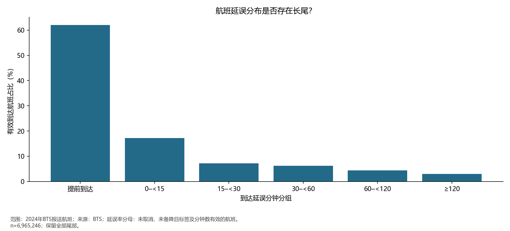
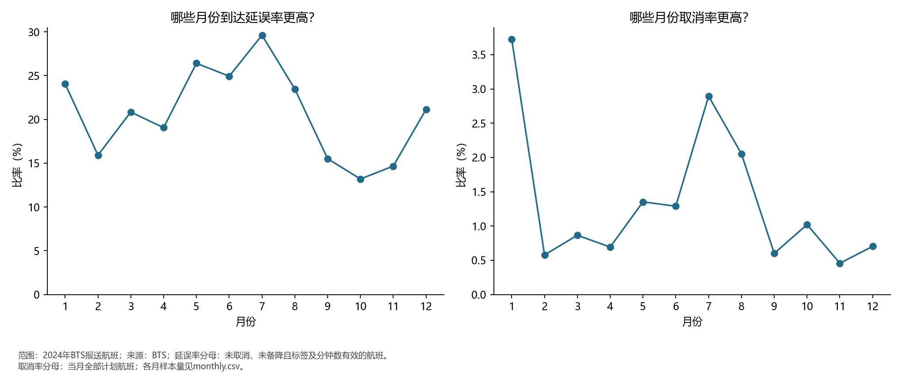
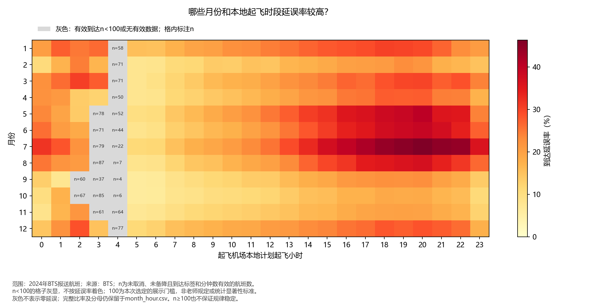
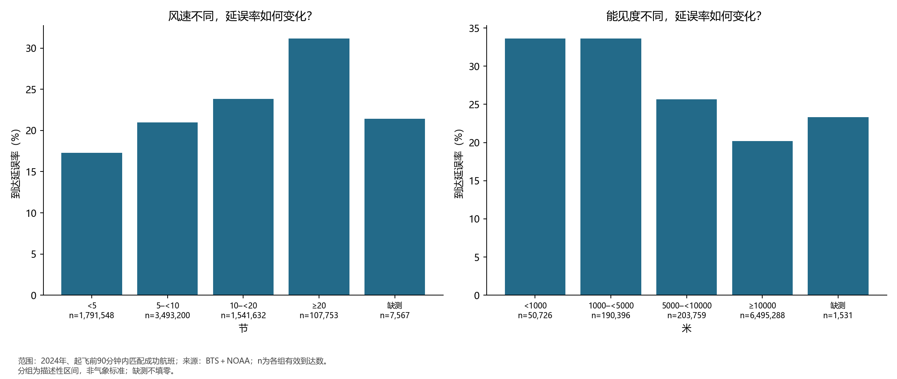
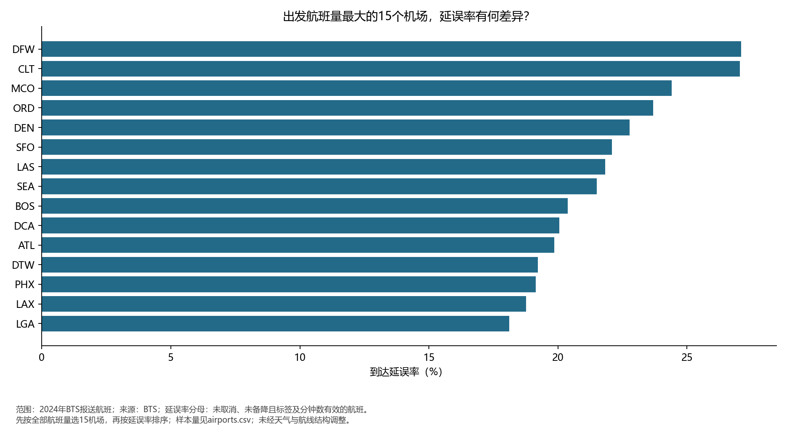
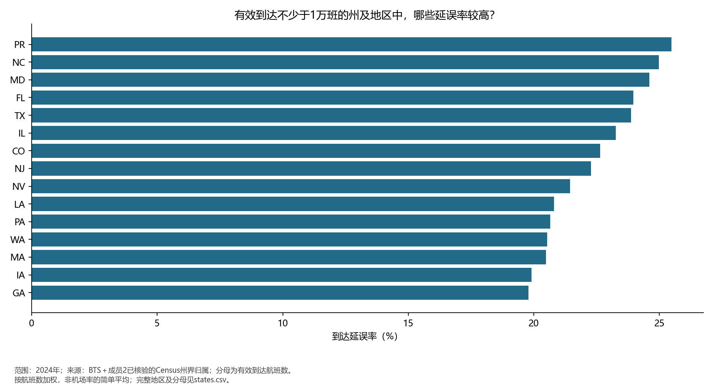
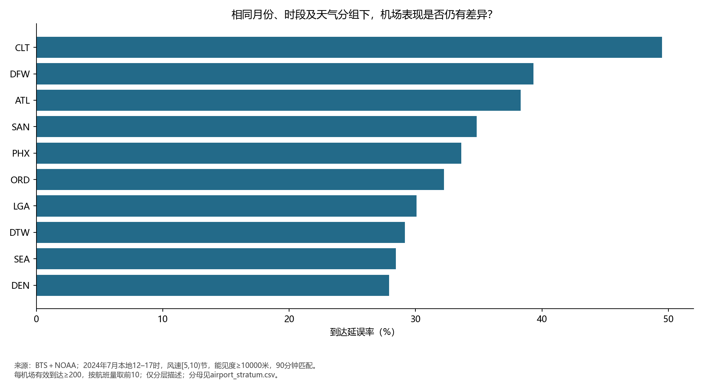

# 第三部分 描述性统计与时空分析

负责人：朱王祯｜计算日期：2026-11-04｜数据期：2024全年

## 1 数据与统计口径

读取成员2全年融合主表，共7,079,060班，覆盖348个出发机场、15个报送航司代码。输入SHA-256：`7eb3dc4b1eceaf994207717f3460f6df7d0a519c21b3f4ecb2f9654d592f610b`，与交付清单一致。未使用前2万行样本代替全年。研究对象仅为BTS报送范围。

延误率＝未取消、未备降且标签和延误分钟有效的延误≥15分钟航班数÷同口径有效到达航班数。取消率和备降率分别以全部计划航班为分母。月份与星期基于flight_date，小时基于sched_dep_local，星期1表示周一。州级使用origin_polygon_state按航班加权，领地保留独立归属。ArrDelay可为负数，表示提前到达。

总体与时间空间统计使用全部航班；天气比较仅使用matched（起飞前0–90分钟）记录，缺测独立分组，不填无雨或零风速。降水仅比较1小时累计，其他时长独立列出。同一天气观测可对应多班航班，结果为航班加权而非独立气象观测统计。

## 2 总体规模与延误分布

有效到达6,965,246班（98.39%），排除113,814班；延误1,449,966班，延误率**20.82%**。取消96,315班，取消率**1.36%**；备降17,499班（0.25%）。

有效到达平均延误7.10分钟，中位数-6分钟，P90=43、P95=83、P99=215分钟，最小-126、最大3803分钟。均值与中位数差异提示长尾影响。极端值保留，未逐班核实原因，不能直接认定为错误。

## 3 时间变化

月度延误率最高为7月（29.62%），最低为10月（13.20%）。这是一年月际差异，不能推广为多年稳定规律。月份、星期、本地小时及月份×小时的全部分子分母分别见monthly、weekday、hourly、month_hour表。

热力图以有效到达数n<100为灰显门槛，并标注n；灰色不代表零延误。100是本次选定的展示规则，非老师规定或显著性标准，n≥100也不保证规律稳定。288格中21格灰显，包括9月4时n=4和10月4时n=6；完整比率与分母仍保留于month_hour.csv。

## 4 天气与运行表现的描述性关联

90分钟匹配成功7,055,161班（99.66%）；60分钟内7,047,642班。天气要素缺失见weather_missingness.csv；匹配成功不等于要素全部有效。

风速<5节组延误率17.30%，≥20节组31.16%；能见度<1000米组33.61%，≥10000米组20.20%。这只说明样本内关联，机场、季节、航司、航线结构可能混杂，不能解释为因果。

天气表同时保留全部航班量、有效到达、延误数、取消数及各自比率。60min表提供窗口敏感性检查；quality_1_5表仅保留该要素质量码1/5，是保守子集检查，不声称其他质量码均错误。不对相关观测套用独立二项假设，不提供未经处理的显著性结论。

## 5 机场地区与相近条件比较

机场图先选全年出发量前15再排序；地区图设置有效到达≥1万班门槛，完整机场、州、航司及有向航线表均保留。州归属沿用成员2核验结果；现有包缺少州界几何文件，因此使用州级条形图，未绘制州界地图。

固定7月、本地12–17时、风速[5,10)节、能见度≥10000米与90分钟匹配，共119,005班，有效到达115,417班。机场和有向航线分层表采用有效到达≥200的展示门槛。该预设分层只示范相近条件比较，仍有组内天气及航线、航司差异，不能称为回归调整后的排名。

## 6 交接与局限

天气分组提供第一个核心问题的描述性证据；机场与航线分层提供第二个问题的初步证据；时空汇总为区域季节问题提供基础。单独的BTS月度或州级统计不能冒充完整多源核心问题答案。成员4继续回归调整，成员5在机场表基础上另定覆盖门槛及特征标准化。

本次实际自动核验包括输入校验值、全年行数、年份、标签阈值一致性、天气时间窗口、各分组行数/有效分母/延误数加总。未重新执行原始采集、全量清洗或逐条人工核查，原始规模≥2GB、单源占比和三类来源要求仍须全组用采集材料验证。AI实际协助与待人工审核事项见AI_USAGE.md。

本次完善已在完整输入目录重新运行verify_member3.py，按Parquet分块独立累计总体及12个月的分子分母，与交付统计表比较通过；实际执行时间为2026-11-04T23:08:37+08:00。这是程序复算记录，不等于新增人工审核已完成。状态及结果见validation.json。
